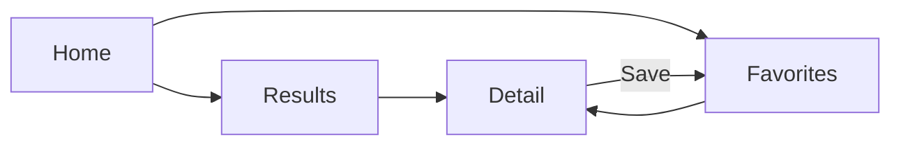
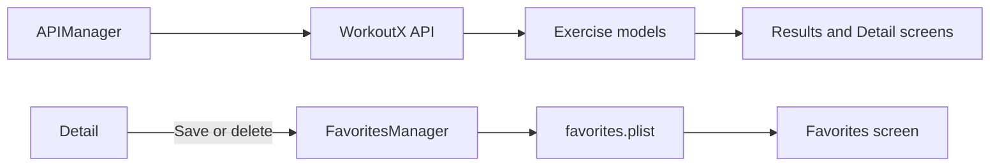

# Gym Buddy

A clean, dark-themed iOS exercise reference app for looking up workouts by muscle group and saving the ones you want to revisit.


## Overview

Gym Buddy helps you find exercises for a body part, review the target muscle, equipment, and difficulty, and follow step-by-step form instructions. Favorites are stored on device so your list is waiting the next time you open the app. The UI uses a dark theme and the Bebas Neue typeface on the home screen.

## Features

- Search exercises by muscle group or body part through the WorkoutX API
- Browse a results list of matching exercises
- Open a detail screen with target muscle, equipment, difficulty, and expandable step-by-step instructions
- Save favorites, persisted locally with `PropertyListEncoder` to a plist file
- Swipe to delete favorites
- Dark theme with the Bebas Neue font

Supported body parts: chest, back, shoulders, upper arms, lower arms, upper legs, lower legs, waist, cardio, and neck.

## Tech Stack

- Swift 5 and UIKit
- Storyboards for the results, detail, and favorites screens; the home screen is built in code
- `URLSession` for networking
- `Codable` models for the WorkoutX response
- `PropertyListEncoder` / `PropertyListDecoder` for local favorites
- Custom fonts via `UIAppFonts`

## Project Structure

| File | Role |
| --- | --- |
| `AppDelegate.swift` | App entry point. Sets up the window and root navigation controller. |
| `SceneDelegate.swift` | Scene lifecycle. Creates the window, applies the dark navigation bar style, and presents `HomeViewController`. |
| `HomeViewController.swift` | Home screen: body-part search field, Search and View Favorites buttons, and the about / how-to copy. Also defines the shared `.gymBackground` color. |
| `ResultsViewController.swift` | Table of exercises returned for the searched body part. Tapping a row opens the detail screen. |
| `ExerciseDetailViewController.swift` | Exercise detail: target muscle, equipment, difficulty, expandable instructions, and Save to Favorites. |
| `FavoritesViewController.swift` | Saved exercises list with swipe-to-delete. Tapping a row reopens the detail screen. |
| `APIManager.swift` | Singleton that calls the WorkoutX exercises endpoint and decodes the JSON into `Exercise` models. Reads the API key from bundled `Secrets.plist`. |
| `Exercise.swift` | `Exercise` and `ExerciseResponse` models, plus helpers for formatted instructions and shortened text. |
| `FavoritesManager.swift` | Singleton that saves and loads favorites as a plist in the app's Documents directory. |
| `Secrets.example.plist` | Template for your WorkoutX API key. Copy this to `Secrets.plist` before building. |
| `Info.plist` | App configuration, including the Bebas Neue font registration. |
| `Base.lproj/Main.storyboard` | Storyboard scenes for results, detail, and favorites. |
| `Base.lproj/LaunchScreen.storyboard` | Launch screen. |
| `Assets.xcassets` | App icon and accent color. |
| `BebasNeue-Regular.ttf` | Display font used on the home title. |

## App Flow



## Data Flow



## Getting Started

### Requirements

- A Mac with Xcode 26 or later
- An iOS Simulator or device running iOS 26.4 or later
- A WorkoutX API key

### Setup

1. Clone this repository, then open the Xcode project:

   ```bash
   git clone <repo-url>
   cd gym-buddy
   open "Gym Buddy.xcodeproj"
   ```

2. Get a WorkoutX API key from [WorkoutX](https://workoutxapp.com).

3. Copy the example secrets file and add your key:

   ```bash
   cp "Gym Buddy/Secrets.example.plist" "Gym Buddy/Secrets.plist"
   ```

   Open `Gym Buddy/Secrets.plist` and replace `YOUR_WORKOUTX_API_KEY` with your key. `Secrets.plist` is gitignored and is never committed.

4. In Xcode, choose an iPhone simulator (or a connected device), then run the app with Product → Run (⌘R).

If `Secrets.plist` is missing or the key is still a placeholder, the app will print a clear error in the Xcode console and the search will return no results.

## How It Works

On launch, `SceneDelegate` presents `HomeViewController` inside a navigation controller and styles the bar to match the dark theme. Entering a body part and tapping Search pushes `ResultsViewController`, which asks `APIManager` to request `https://api.workoutxapp.com/v1/exercises/bodyPart/{bodyPart}` with your key in the `X-WorkoutX-Key` header. The JSON is decoded into `Exercise` models and shown in a table.

Selecting an exercise opens `ExerciseDetailViewController`, which shows the target muscle, equipment, and difficulty. Instructions start truncated and expand or collapse with Show More / Show Less. Saving an exercise appends it to the list managed by `FavoritesManager`, which writes `[Exercise]` to `favorites.plist` in the Documents directory with `PropertyListEncoder`. The Favorites screen reloads that file whenever it appears, and swiping a row deletes it and writes the updated list back to disk.

## Future Improvements

- Loading indicators and richer empty or error states on the results and favorites screens
- Use the unused `type` and `difficulty` parameters, plus the `gifUrl` already present on the model, to filter results and preview form
- Search suggestions or recent body-part history on the home screen
- Sync favorites across devices

<!-- Screenshots
Add app screenshots here once available:
- Home
- Results
- Exercise Detail
- Favorites
-->

## Author

**Oshan Karunarathna**

- GitHub: [OshanK1018](https://github.com/OshanK1018)
- LinkedIn: [oshan1018](https://www.linkedin.com/in/oshan1018/)
